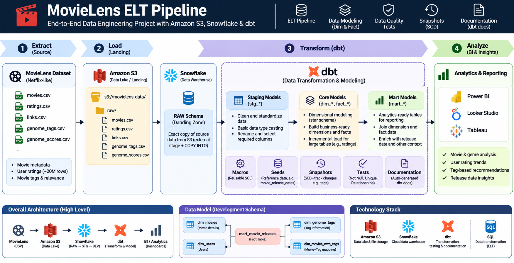
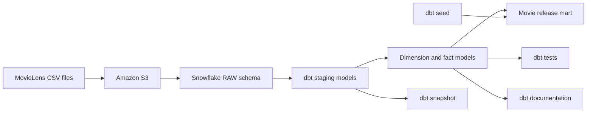

# MovieLens ELT Pipeline

An end-to-end data engineering project that uses **MovieLens data,
Amazon S3, Snowflake, and dbt** to demonstrate a cloud-based ELT
workflow. The project loads raw movie-related CSV data into Snowflake,
transforms it with modular dbt models, and adds dimensional models, an
incremental fact model, a seed, a snapshot, reusable macros, data
quality tests, and generated documentation.

> **Project focus:** ELT and analytics engineering with dbt and
> Snowflake. dbt handles the transformation layer; the initial file
> upload and raw-data loading into Snowflake happen before dbt models
> are run.

------------------------------------------------------------------------

## Table of Contents

-   [Overview](#overview)
-   [Architecture](#architecture)
-   [Technology Stack](#technology-stack)
-   [Dataset](#dataset)
-   [Data Models](#data-models)
-   [Additional dbt Features](#additional-dbt-features)
-   [Project Structure](#project-structure)
-   [Prerequisites](#prerequisites)
-   [Setup and Configuration](#setup-and-configuration)
-   [Running the Pipeline](#running-the-pipeline)
-   [Data Quality](#data-quality)
-   [dbt Documentation](#dbt-documentation)
-   [Security Notes](#security-notes)
-   [Current Scope and Future
    Improvements](#current-scope-and-future-improvements)
-   [References](#references)

## Overview

The goal of this project is to turn raw MovieLens data into structured,
analytics-ready datasets in Snowflake.

The workflow follows **Extract → Load → Transform (ELT)**:

1.  **Extract:** Obtain the MovieLens CSV dataset.
2.  **Load:** Upload the source files to Amazon S3 and load them into
    Snowflake's raw landing schema.
3.  **Transform:** Use dbt to standardize raw columns, convert
    timestamps, build dimensions and facts, and create a reporting mart.
4.  **Validate and document:** Run dbt tests, maintain a tag snapshot,
    and generate model documentation.

The raw layer is retained separately from dbt's transformed models so
that transformations can be rebuilt without changing the original
landing data.

## 🏗️ Project Architecture



## Architecture



### Pipeline layers

  -----------------------------------------------------------------------
  Layer                               Responsibility
  ----------------------------------- -----------------------------------
  Source files                        MovieLens CSV data

  Amazon S3                           Cloud object storage for the source
                                      files

  Snowflake `RAW`                     Raw landing tables loaded before
                                      dbt transformations

  dbt staging                         Standardize source column names and
                                      data types

  dbt dimensions and facts            Build reusable analytical entities
                                      and measures

  dbt mart                            Combine transformed ratings with
                                      movie release-date reference data

  dbt quality and documentation       Validate model data and describe
                                      the project
  -----------------------------------------------------------------------

The dbt project expects the raw Snowflake tables to be available before
the dbt run begins. S3-to-Snowflake loading is an ingestion step outside
dbt's SQL transformation models.

## Technology Stack

-   **Amazon S3** --- source-file storage
-   **Snowflake** --- cloud data warehouse and SQL execution engine
-   **dbt Core** --- SQL transformations, model dependencies, tests,
    snapshots, seeds, macros, and documentation
-   **dbt-snowflake** --- dbt adapter for Snowflake
-   **SQL** --- transformation logic
-   **Python** --- local development environment for dbt

## Dataset

This project uses the **MovieLens 20M** dataset from GroupLens. The
dataset contains movie metadata, user ratings, user-generated tags,
external movie identifiers, and tag-genome relevance scores.

Source: [GroupLens MovieLens 20M
Dataset](https://grouplens.org/datasets/movielens/20m/)

### Source files and raw tables

  -----------------------------------------------------------------------
  MovieLens file          Snowflake raw table     Description
  ----------------------- ----------------------- -----------------------
  `movies.csv`            `RAW_MOVIES`            Movie identifiers,
                                                  titles, and genres

  `ratings.csv`           `RAW_RATINGS`           User ratings and rating
                                                  timestamps

  `tags.csv`              `RAW_TAGS`              User-generated movie
                                                  tags and timestamps

  `links.csv`             `RAW_LINKS`             IMDb and TMDb
                                                  identifiers for movies

  `genome-tags.csv`       `RAW_GENOME_TAGS`       Genome tag identifiers
                                                  and labels

  `genome-scores.csv`     `RAW_GENOME_SCORES`     Relevance scores for
                                                  movie/tag combinations
  -----------------------------------------------------------------------

### Approximate data scale

The following values come from the generated Snowflake dbt catalog and
are approximate; they can change when the warehouse data is refreshed.

  Dataset / model     Approximate rows
  ----------------- ------------------
  Ratings                   20,000,263
  Tags                         465,561
  Genome scores             11,709,768
  Movies                        27,278
  Users                        138,493
  Genome tags                    1,128

## Data Models

The dbt project organizes transformations into staging, dimension, fact,
and mart models.

### 1. Staging models

Staging models read from the raw Snowflake tables and prepare consistent
fields for downstream transformations.

  -----------------------------------------------------------------------
  Model                               Transformation
  ----------------------------------- -----------------------------------
  `src_movies`                        Selects movie fields and
                                      standardizes the movie identifier

  `src_ratings`                       Renames user/movie identifiers and
                                      converts the Unix timestamp to a
                                      Snowflake timestamp

  `src_tags`                          Renames user/movie identifiers and
                                      converts the tag timestamp

  `src_links`                         Standardizes movie, IMDb, and TMDb
                                      identifiers

  `src_genome_tags`                   Standardizes genome tag identifiers
                                      and labels

  `src_genome_score`                  Standardizes movie/tag identifiers
                                      and relevance values
  -----------------------------------------------------------------------

### 2. Dimension models

  -----------------------------------------------------------------------
  Model                               Purpose
  ----------------------------------- -----------------------------------
  `dim_movies`                        Cleans movie titles and creates an
                                      array representation of genres

  `dim_users`                         Builds a distinct user list from
                                      both ratings and tags

  `dim_genome_tags`                   Trims and standardizes genome tag
                                      labels
  -----------------------------------------------------------------------

### 3. Fact models

  -----------------------------------------------------------------------
  Model                   Purpose                 Materialization
  ----------------------- ----------------------- -----------------------
  `fct_ratings`           Stores user ratings     Incremental
                          with movie/user         
                          identifiers and rating  
                          timestamps              

  `fct_genome_scores`     Stores movie/tag        Table
                          relevance scores,       
                          filters out             
                          non-positive relevance  
                          values, and rounds      
                          scores to four decimal  
                          places                  
  -----------------------------------------------------------------------

The `fct_ratings` model uses dbt's `is_incremental()` condition to
select records with a `rating_timestamp` later than the maximum
timestamp already present in the target table. It also sets
`on_schema_change='fail'`.

### 4. Mart model

  -----------------------------------------------------------------------
  Model                   Purpose                 Materialization
  ----------------------- ----------------------- -----------------------
  `mart_movie_releases`   Joins the ratings fact  Table
                          with the release-date   
                          seed and labels         
                          release-date            
                          availability as `known` 
                          or `unknown`            

  -----------------------------------------------------------------------

### 5. Ephemeral model

`dim_movies_with_tags` is configured as an **ephemeral** model. It
combines movie, genome-tag, and relevance-score information as a
reusable SQL subquery rather than creating a standalone table or view.

**Validation note:** In the uploaded manifest, this model references
`tag_name`, while `dim_genome_tags` exposes the column `tag`. Align that
reference before using this model in a downstream model or presenting it
as a validated output.

## Additional dbt Features

### Seeds

The project includes:

-   `seed_movie_release_dates.csv`

This seed provides a small local reference mapping of movie IDs to
release dates. dbt loads it into Snowflake and the `mart_movie_releases`
model uses it to identify whether release-date information is available.

Run it with:

``` bash
dbt seed
```

### Snapshots

The project includes the `snap_tags` snapshot.

-   **Strategy:** Timestamp
-   **Unique key:** `user_id`, `movie_id`, and `tag`
-   **Updated-at column:** `tag_timestamp`
-   **Target schema:** `SNAPSHOTS`
-   **Hard-delete handling:** Enabled

The snapshot is configured with a `LIMIT 100` in its source query, so
the current implementation captures a sample of tag records rather than
the full tag dataset. Remove or adjust that limit if the intention is to
snapshot all tag records.

Run snapshots with:

``` bash
dbt snapshot
```

### Macros

The custom macro `no_nulls_in_columns(model)` uses
`adapter.get_columns_in_relation()` to inspect a model's columns and
generate a query that returns rows containing null values in any column.

This macro is called by the singular SQL test for `fct_genome_scores`.

### Tests

The project manifest contains **13 dbt test nodes**:

-   Not-null tests on key columns in the movie, user, genome-tag,
    ratings, and genome-score models
-   A relationship test checking that `fct_ratings.movie_id` maps to
    `dim_movies.movie_id`
-   A singular SQL test that applies the custom `no_nulls_in_columns`
    macro to `fct_genome_scores`

Run tests with:

``` bash
dbt test
```

The command executes the tests against the current warehouse data. Test
results depend on the state of that data at runtime.

### Analysis

The project also contains `analyses/movie_analysis.sql`, an analysis
query that calculates average ratings and rating counts by movie, keeps
movies with more than 100 ratings, and returns the top 20 by average
rating.

## Project Structure

The main dbt resources represented in the project manifest are organized
as follows:

``` text
movielens-elt-pipeline/
├── analyses/
│   └── movie_analysis.sql
├── macros/
│   └── no_nulls_in_columns.sql
├── models/
│   ├── dim/
│   │   ├── dim_genome_tags.sql
│   │   ├── dim_movies.sql
│   │   ├── dim_movies_with_tags.sql
│   │   └── dim_users.sql
│   ├── fact/
│   │   ├── fct_genome_scores.sql
│   │   └── fct_ratings.sql
│   ├── mart/
│   │   └── mart_movie_releases.sql
│   ├── stagging/
│   │   ├── src_genome_score.sql
│   │   ├── src_genome_tags.sql
│   │   ├── src_links.sql
│   │   ├── src_movies.sql
│   │   ├── src_ratings.sql
│   │   └── src_tags.sql
│   └── schema.yml
├── seeds/
│   └── seed_movie_release_dates.csv
├── snapshots/
│   └── snap_tags.sql
├── tests/
│   └── relevence_score_test.sql
├── dbt_project.yml
└── README.md
```

The manifest records the current staging directory as `stagging`.
Consider renaming it to `staging` and aligning the folder configuration
in `dbt_project.yml` if that spelling was unintentional.

## Prerequisites

Before running the dbt project, prepare:

1.  A Snowflake account, warehouse, database, and role with permissions
    to create and query the required schemas and relations.
2.  An Amazon S3 bucket containing the MovieLens CSV files.
3.  A Snowflake stage and file format configured to read the S3 files,
    plus the raw landing tables.
4.  Python installed locally.
5.  dbt Core with the `dbt-snowflake` adapter.
6.  A local dbt profile configured for this project.

## Setup and Configuration

### 1. Clone the repository

``` bash
git clone https://github.com/MasumRaza1/movielens-elt-pipeline.git
cd movielens-elt-pipeline
```

### 2. Create and activate a Python virtual environment

**Windows PowerShell:**

``` powershell
python -m venv .venv
.\.venv\Scripts\Activate.ps1
```

**macOS / Linux:**

``` bash
python -m venv .venv
source .venv/bin/activate
```

### 3. Install the Snowflake adapter

``` bash
pip install dbt-snowflake
```

Verify the installation:

``` bash
dbt --version
```

### 4. Configure the dbt profile

Create or update your local `profiles.yml` in the dbt profiles
directory:

-   Windows: `%USERPROFILE%\.dbt\profiles.yml`
-   macOS / Linux: `~/.dbt/profiles.yml`

Configure the profile name, Snowflake account, user, authentication
method, role, warehouse, database, schema, and thread settings to match
the `profile:` and target configuration in `dbt_project.yml`.

Keep credentials in your local profile or a secure secrets mechanism. Do
not commit `profiles.yml` to GitHub.

### 5. Prepare the raw Snowflake data

Download the MovieLens 20M CSV files, upload them to your S3 bucket, and
load them into the six raw Snowflake tables listed in the
[Dataset](#dataset) section. Configure the Snowflake stage, file format,
and `COPY INTO` statements for your own AWS and Snowflake environment.

The dbt source definitions expect the raw tables to exist in the
Snowflake `RAW` schema before the dbt transformations run.

### 6. Check the connection

From the project root, run:

``` bash
dbt debug
```

Resolve any profile or connection errors before proceeding.

## Running the Pipeline

Run the commands from the directory containing `dbt_project.yml`.

``` bash
# Install dbt packages declared by the project
dbt deps

# Load the local release-date seed
dbt seed

# Build dbt models
dbt run

# Update the tag snapshot
dbt snapshot

# Execute data quality tests
dbt test
```

You can also run an individual model or test selection, for example:

``` bash
dbt run --select dim_movies
dbt test --select relevence_score_test
```

The raw S3-to-Snowflake ingestion step must be completed before these
dbt commands.

## Data Quality

Data quality is enforced through dbt schema tests and a custom singular
test. The current test definitions cover:

-   Required values in selected dimension and fact columns
-   Referential integrity between ratings and the movie dimension
-   Null checks across all columns of the genome-score fact model

Use `dbt test` to execute the checks and review the terminal output for
pass, fail, or error results.

## dbt Documentation

Generate the documentation artifacts:

``` bash
dbt docs generate
```

Start the local documentation site:

``` bash
dbt docs serve
```

Open the localhost URL printed in the terminal. The dbt documentation
site includes model descriptions, column metadata, and the model
dependency graph (lineage).

The generated `target/` directory is build output and is intentionally
excluded from Git. Run the commands above locally whenever you want to
regenerate and view the documentation.

## Security Notes

-   Never commit `profiles.yml`, `.env`, AWS access keys, AWS secret
    keys, private keys, passwords, or tokens.
-   Keep local virtual environments, dbt build output, logs, and
    installed packages out of version control.
-   Do not publish raw data files if the repository does not need them;
    use the dataset's official source instead.
-   Use a secure Snowflake-to-S3 access configuration, such as a storage
    integration where appropriate, rather than hard-coding long-lived
    credentials in SQL or source control.

## Current Scope and Future Improvements

The current repository focuses on the S3-to-Snowflake landing workflow
and dbt transformation layer. The following are possible next steps, not
features claimed as already implemented:

-   Correct and validate the `dim_movies_with_tags` column reference.
-   Remove or parameterize the `LIMIT 100` in `snap_tags` if
    full-history tracking is required.
-   Rename `models/stagging/` to `models/staging/` and align the project
    configuration.
-   Add automated orchestration and scheduled execution.
-   Add CI checks for dbt compilation and tests.
-   Add a BI dashboard using the curated Snowflake models.
-   Add freshness checks and more comprehensive uniqueness,
    accepted-value, and relationship tests.

## References

-   [MovieLens 20M Dataset ---
    GroupLens](https://grouplens.org/datasets/movielens/20m/)
-   [dbt Documentation](https://docs.getdbt.com/)
-   [Snowflake Documentation](https://docs.snowflake.com/)
-   [Amazon S3 Documentation](https://docs.aws.amazon.com/s3/)
-   [Project tutorial
    reference](https://www.youtube.com/watch?v=zZVQluYDwYY)

------------------------------------------------------------------------

*This README describes the project structure and metadata available in
the uploaded dbt manifest and catalog, together with the supplied
tutorial transcript. Row counts are approximate catalog values; model
behavior and test outcomes should be rechecked against the current
Snowflake environment.*
